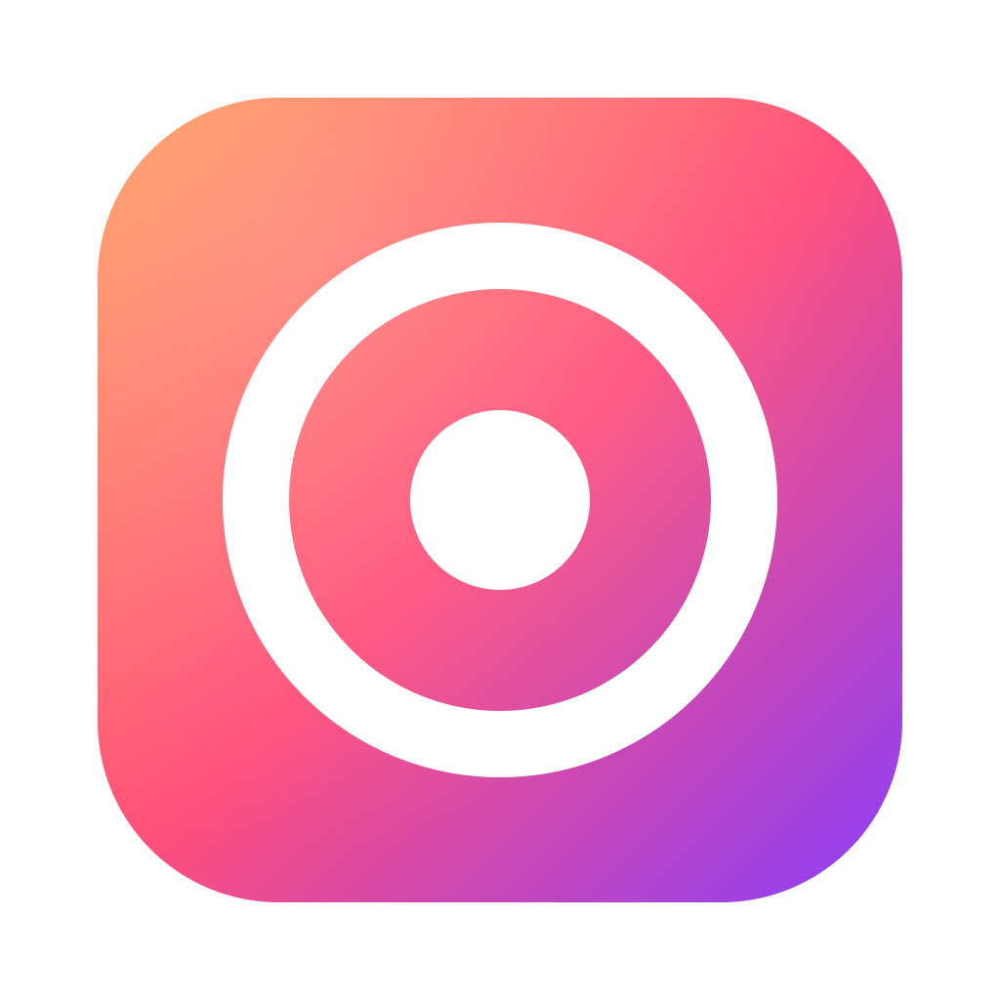
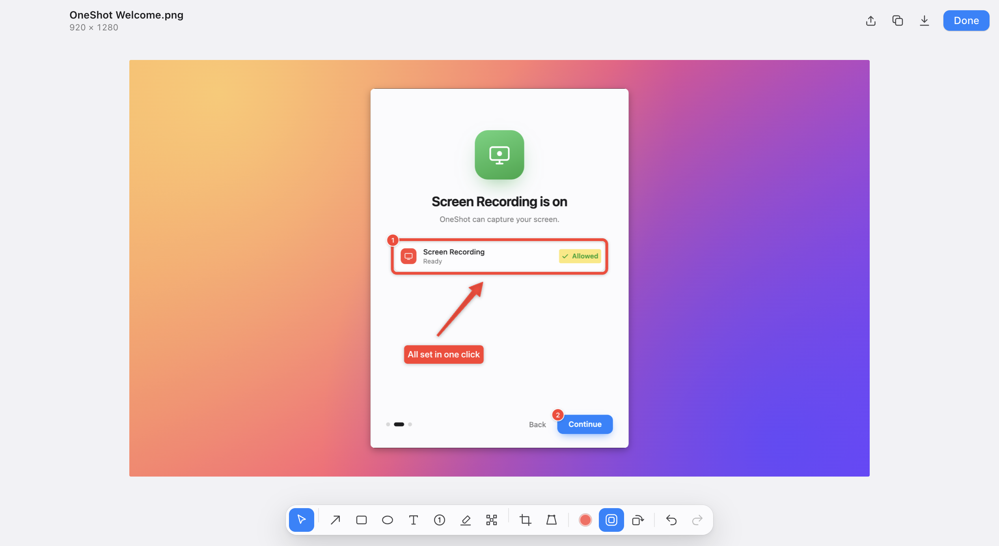

<p align="center"></p>

# OneShot

**A free, open-source screenshot tool and image viewer.** Press a key, get a good-looking screenshot. Annotate it, drop it on a gradient, drag it straight into Slack. Double-click any image and OneShot opens it as a quiet viewer that hides a full editor.



> **Status:** early prototype (v0.1.x). Built and tested on macOS. Windows and Linux builds work with full-screen capture only (area and window selection are macOS-only for now).

## Download
Get the latest build from [Releases](https://github.com/fabianfreund/OneShot/releases/latest): a signed and notarized `.dmg` for macOS (Apple Silicon or Intel), an `.exe` installer for Windows, and an `.AppImage` / `.deb` for Linux.

## Highlights
- **Capture in one key:** area, window or full screen. A quick-access card slides in with Copy, Annotate, Pin, Save and drag-out.
- **Annotate with good defaults:** tapered arrows, boxes, ellipses, text (plain, outline, pill), numbered counters, highlighter, pixelate.
- **Beautify:** gradient backgrounds with padding, rounded corners, shadow and fixed aspect ratios.
- **Photo tools too:** crop, perspective crop (straighten a photographed document), rotate and flip.
- **Pin to screen:** keep a capture floating on top as a reference.
- **Default image viewer:** borderless viewer that flips through the folder with ← →, and turns into the editor with **E**.
- **Lives in the menu bar:** no Dock icon unless an image is open.

## Shortcuts
| | |
|---|---|
| ⌥⇧4 / ⌥⇧5 / ⌥⇧3 | Capture area / window / screen |
| Viewer | ← → browse · pinch or ⌘± zoom · ⌘0 fit · ⌘1 actual size · **E** or double-click to edit |
| Tools | V select · A arrow · R rect · O ellipse · T text · N counter · H highlight · B pixelate · C crop · P perspective |
| Editing | ⇧ constrain · ⌫ delete · arrows nudge · ↩ apply crop · esc back · ⌘Z / ⇧⌘Z · ⌘C copy · ⌘S save |

On Windows and Linux use Ctrl for ⌘ and Alt for ⌥.

## Quick start
```bash
npm install
npm start                     # menu-bar app; first run shows the welcome + permission screen
npm start -- ~/Desktop/x.png  # open an image directly
npm run check                 # lint + unit tests + end-to-end smoke test
npm run dist:mac              # or dist:win, dist:linux, dist:all → dist/
```
On macOS, dev builds get the Screen Recording permission through the terminal you ran `npm start` from. Relaunch after allowing it.

Releases are one command: `npm run release:patch` (or `:minor`, `:major`) tests, bumps the version, builds and notarizes the Mac version locally and publishes the GitHub Release. CI then adds the Windows and Linux builds. Details in [docs/DEVELOPMENT.md](docs/DEVELOPMENT.md).

## Project layout
```
main.js              menu bar, shortcuts, capture, windows, IPC
preload.js           safe bridge to the pages (window.oneshot)
renderer/editor/     viewer + editor (document model, perspective warp, drawing, tools, UI)
renderer/*.html      capture overlay, pinned image, capture bar, welcome screen
scripts/             icon generator, smoke test, mac release (sign + notarize)
test/                unit tests (node:test)
docs/                development guide, research and plan
```
More detail is in [docs/DEVELOPMENT.md](docs/DEVELOPMENT.md) (building, releasing, testing, debug hooks) and [docs/RESEARCH.md](docs/RESEARCH.md) (feature research and technical plan).

## Built with
[Electron](https://www.electronjs.org) and [electron-builder](https://www.electron.build). Everything else is plain JavaScript, HTML canvas and CSS, with no runtime dependencies. On macOS, capture uses the system `screencapture` tool.

## About
OneShot is made by **Fabian Builds** ([@fabianfreund](https://github.com/fabianfreund)).

**Built with AI.** Most of OneShot's code, design and docs were written with [Claude Code](https://claude.com/claude-code), steered and reviewed by a human. If you don't want to use or support software made with AI tools, that's a fair choice, and OneShot isn't for you. There are great hand-made alternatives.

OneShot is not affiliated with CleanShot X or any other screenshot app.

## License
[MIT](LICENSE).
